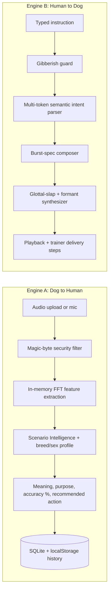

# CanineSense AI — Executive Summary

*Dual-engine, breed- and sex-calibrated bioacoustic communication platform. Verified against the codebase on disk: 99/99 backend tests pass, frontend build clean (see the forensic audit).*

---

## 1. Problem Statement

Humans and dogs share homes but not a language, and the gap causes real harm.

- **Misread vocalizations.** A play bark, a stranger alert, a distress yelp and a pain whimper can look alike to an owner. Guessing wrong means ignoring a dog in distress, or punishing one that is only excited.
- **Clinical stress.** Dogs often arrive at veterinary clinics and grooming tables already anxious. Handlers rarely have a calming signal the dog recognises, so exams take longer and are riskier for dog and staff.
- **Ineffective training.** Yelling is the default human response. To a dog it is a loud, confusing noise, and it raises arousal when the goal was to lower it.
- **Existing "dog translator" apps are not credible.** They typically:
  - play a random preset soundboard clip, whatever you typed;
  - synthesize a continuous sine-wave sweep, which sounds like an alarm or siren and is nothing like a mammalian voice;
  - ignore breed and sex, although vocal-fold size and vocal-tract length change pitch and formants;
  - accept any input, including keyboard mashing, and still "translate" it.

---

## 2. Core Objective & Vision

CanineSense AI is a **dual-engine bioacoustic intelligence platform** for pet families, trainers and veterinary clinics.

| Direction | Engine | Goal |
|---|---|---|
| Dog → Human | **Engine A** | Turn a recorded dog sound into plain-English meaning, purpose, a confidence figure and a recommended action. |
| Human → Dog | **Engine B** | Turn a typed human instruction into a synthesized, mammalian canine vocal cue, with trainer delivery steps. |

Both engines are **calibrated by breed and sex** (32-breed intelligence database; male/female acoustic dimorphism). The aim is honest, explainable bioacoustics instead of novelty.

---

## 3. Core Motive & Real-World Impact

- **Canine welfare.** Calmer handling and fewer mis-corrections, so less fear-based training.
- **Lower clinic and grooming anxiety.** Low-arousal "calming chuff" cues with delivery instructions, such as volume, timing and hand contact, for exams.
- **Household safety.** Helps tell stranger/intruder alerts from play or distress, so owners respond proportionately.
- **Accessible science.** Spectral features are shown in plain language for ages 10+, with the underlying metrics (F0, centroid, RMS, onset rate) available to trainers and veterinary professionals.

---

## 4. System Architecture & Dual-Engine Pipeline

**Stack:** FastAPI + SQLAlchemy/SQLite backend (`backend/app`), React + TypeScript + Vite frontend.

### Engine A — Dog-to-Human Meaning Decoder
- `POST /api/recordings/quick-analyze` (`recordings.py`) reads the upload **in memory** and extracts:
  - `f0_mean`: dominant fundamental frequency;
  - `spectral_centroid`: brightness of the spectrum;
  - `rms`: energy;
  - `onset_rate`: burst onsets per second.
- **Scenario Intelligence** (`services/scenario_intelligence.py`) combines those features with the selected dog's breed/sex profile and outputs meaning, purpose, accuracy %, and a recommended owner or clinic action.
- A `models.Recording` row and a `models.Analysis` row are committed to SQLite, and the frontend mirrors them to `cs_saved_history_v1`.

### Engine B — Human-to-Dog Voice Communicator
1. **Linguistic gibberish guard** (`isGibberishInput`): blocks 6+ consecutive consonants, single tokens over 14 characters, and a vowel ratio under 0.15 or over 0.85. Blocked input shows a warning and plays no audio.
2. **Multi-token semantic intent parser** (`buildCueForHumanSentence`): word-boundary keyword rules in priority order (play/retrieve, calm, vet, stop, praise/food, recall). Unmatched valid text goes to a dynamic word-cadence generator. Typed cues get unique `custom_*` ids, so they never collide with the preset cards.
3. **Mammalian vocal-tract synthesizer:** see Section 5.

---

## 5. Deep Dive: How Dog Voice Generation Works

Implemented in `frontend/src/pages/Communicate.tsx` (`synthesizeMammalianDogVoiceWav`) and `backend/app/services/synthesis.py` (`_synthesize_single_event`). Both follow a **source–filter model**: a vocal-fold *source* shaped by the throat and muzzle *filter*, the same model used in mammal bioacoustics.

**1. Discrete bursts, not sweeps.** Each cue is a list of short percussive bursts separated by silence:

| Vocalization | Burst duration |
|---|---|
| yip / bark | 90–140 ms |
| grunt / soft attention | 180–240 ms |
| growl | 450–600 ms |
| whine / howl | multi-burst contours |

A continuous sine glide, the usual "siren", is never generated.

**2. Asymmetric Rosenberg glottal pulse.** The source is a pulse train, not a sinusoid:

$$g(p)=\begin{cases}\tfrac12\left(1-\cos\frac{\pi p}{T_o}\right) & p<T_o \\ \cos\!\left(\frac{\pi}{2}\,\frac{p-T_o}{T_c}\right) & T_o\le p<T_o+T_c \\ 0 & \text{otherwise}\end{cases}$$

where $p\in[0,1)$ is the glottal phase, $T_o\approx0.58$ is the slow opening phase and $T_c\approx0.14$ is the rapid closure. The sharp closure gives the harmonic-rich "slap" of a real bark.

**3. Sub-harmonic chest fry.** A second pulse at $0.5\times F_0$ is mixed in. It adds the roughness of a growl or chest bark. The frontend also adds a $0.333\times F_0$ term.

**4. Pink-filtered airflow turbulence.** Noise is shaped to a roughly $1/f$ spectrum (backend: a pink IIR filter; frontend: a one-pole low-pass). It is strongest at burst onset, modelling the breath through the muzzle.

**5. Pitch contour and jitter.** Each burst rises quickly to a peak and then falls. Cycle-to-cycle micro-jitter, about 3%, removes the robotic regularity.

**6. Two-pole formant resonators.** The excitation passes through resonators of the form

$$y[n]=x[n]-a_1\,y[n-1]-a_2\,y[n-2],\quad a_1=-2r\cos\tfrac{2\pi F}{f_s},\; a_2=r^2$$

- $F_1\approx 620\ \text{Hz}$ models the pharyngeal throat cavity.
- $F_2\approx 1450\ \text{Hz}$ models the oral/muzzle cavity.

Formant positions, burst rhythm and pitch vary with the parsed intent and the words typed.

**7. Breed and sex scaling.**
- *Breed (Communicate.tsx):* a three-tier scale from the breed name. Toy/short-muzzle breeds are about ×1.24, large guard breeds about ×0.82, and others ×1.0. This is a simple lookup, not a measured skull model. The backend scales formants by base pitch (clipped to 0.80–1.25×).
- *Sex dimorphism:* male ×0.91 (**−9%**) and female ×1.08 (**+8%**), in both `breed_intelligence.py` (F0 range, synth pitch, formants) and the frontend (×0.91 / ×1.08).

**8. Soft-tissue saturation and normalization.** `tanh` saturation models tissue non-linearity, followed by peak normalization and an 8 ms attack with exponential decay per burst, so each burst starts sharply and decays naturally.

---

## 6. Complete Feature Matrix

| Area | Feature | Status |
|---|---|---|
| Engine A | In-memory FFT features (f0, centroid, RMS, onset rate) | Implemented |
| Engine A | Scenario Intelligence with meaning, purpose, accuracy % and action | Implemented |
| Engine B | Gibberish guard, semantic intent parser, glottal-formant synthesizer | Implemented |
| Engine B | 6 trained cue cards with trainer and clinic delivery steps | Implemented |
| Engine B | Dynamic cue for any valid sentence | Implemented |
| Intelligence | 32-breed database (Stanley Coren intelligence ranking), `BREED_DB` | Implemented |
| Intelligence | Male/Female acoustic dimorphism (−9% / +8%) | Implemented |
| Profiles | Male/Female selector and gender badges | Implemented |
| Profiles | FIFO auto-prune: oldest 3 removed when more than 10 (verified: 11 created → 8 remain) | Implemented |
| Data | Dual persistence: SQLite + `localStorage` merge (History, Analytics) | Implemented |
| UX | 4 full-screen themes (default + white-black, red-blue, yellow-green) | Implemented |
| UX | Zero popups (compliance modal and cookie banner disabled), zero signup checkboxes | Implemented |
| UX | Separate mic and file-upload busy states | Implemented |
| Deployment | Localhost API routing with no hosted-backend leakage | Implemented |

---

## 7. Defense-in-Depth Security Architecture

| Layer | Control |
|---|---|
| **Binary exploit filtering** | Magic-byte checks reject executables and scripts: `MZ` (Windows PE), `#!/` (shell scripts), `\x7fELF` (Linux binaries) and `<script` / HTML. |
| **Upload limits** | Empty files and files over the maximum size are rejected (400/413). |
| **RAM-only analysis** | Quick-analyze decodes audio from an in-memory buffer (`io.BytesIO`) and extracts features without writing the upload to disk. Only derived metrics are stored. |
| **Authentication** | JWT access tokens with expiry validation (`security.py`). Passwords are hashed with bcrypt at 12 rounds. |
| **Authorization** | Per-user ownership checks on dogs and recordings (isolation covered by tests). |
| **Secret isolation** | `SECRET_KEY` comes from the environment (`CANINESENSE_SECRET_KEY`), with no hardcoded production value. |
| **Verification** | 99 automated tests pass, covering security, isolation, synthesis and communication. |

---

### Scope Notes (for credibility)

- The audio-decoding path above applies to WAV input. For other formats, `quick-analyze` falls back to estimates derived from signal energy.
- The accuracy percentages on the Communicate cue cards are fixed design values. The Engine A accuracy comes from rule-based scenario scoring. Neither is a clinically validated measurement.
- The synthesized sounds are a bioacoustic model of canine calls. They are not proof that a dog understands human language. Treat results as guidance for trainers and owners.
