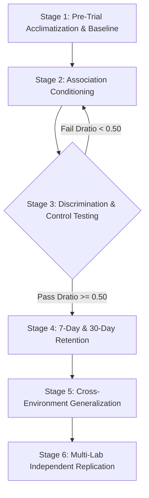

# CanineSense AI — Engine B Experimental Validation Protocol
**Document ID:** `CS-DOC-P7-003`  
**Version:** 2.0.0 (Priority 7 Behavioural Trials)  
**Status:** Approved Research Standard  
**Date:** November 2026  

---

## 1. Scientific Objective & Hypothesis

### 1.1 Central Scientific Question
Can domestic canines (*Canis lupus familiaris*) reliably discriminate synthetic, canine-inspired acoustic vocal cues (Engine B) from acoustic controls, form a conditioned association between a cue and a human intention, and execute a target motor action in the absence of visual, gestural, or verbal handler prompting?

### 1.2 Formal Hypotheses
* **Null Hypothesis ($H_0$):** Canine motor response rates to Target Engine B cues will not significantly exceed response rates to acoustic control conditions (Silence C1, Pure Tone C2, Spectrally Matched Noise C3):
  $$H_0: P(\text{Action} \mid \text{Target}) \le \max\big(P(\text{Action} \mid \text{C1}), P(\text{Action} \mid \text{C2}), P(\text{Action} \mid \text{C3})\big)$$
* **Alternative Hypothesis ($H_1$):** Target Engine B cues elicit intention-congruent motor actions at a rate significantly higher than acoustic controls, demonstrating true acoustic discrimination ($D_{\text{ratio}} \ge 0.50$, $p < 0.01$):
  $$H_1: P(\text{Action} \mid \text{Target}) > \max(P(\text{Action} \mid \text{C1..3})) + \delta, \quad \delta \ge 0.30$$

---

## 2. Six-Stage Validation Methodology

The protocol proceeds through six sequential stages. Advancement to subsequent stages is gated by strict statistical performance criteria:

### Stage 1: Pre-Trial Acclimatization & Baseline Spontaneous Activity
* **Goal:** Measure baseline response to environment, equipment, and ambient silence.
* **Procedure:** Dog is introduced into the test enclosure (minimum 4m $\times$ 4m) for 15 minutes. Three silent trials (C1) and two neutral tone trials (C2) are presented at random intervals (30–90s inter-trial interval, ITI).
* **Criterion:** Zero stress indicators (no lip licking, whale eye, pacing, or freezing). Spontaneous execution of target action during silence must be $\le 10\%$.

### Stage 2: Association Conditioning (Pairing Phase)
* **Goal:** Form associative contingency between synthetic acoustic cue and target action/reward.
* **Procedure:** Classical/operant conditioning sequence:
  1. Emit calibrated Target Engine B Cue ($60.0 - 70.0$ dBA SPL).
  2. Prompt target action using standard lure or familiar verbal bridge if unprompted within 2.0s.
  3. Deliver high-value positive reinforcement upon completion within 0.5s.
  4. Inter-trial interval: 45–90s. Maximum 12 trials per session, 1 session per day.
* **Criterion:** Dog initiates target action upon cue onset prior to prompt in $\ge 80\%$ of trials across two consecutive sessions.

### Stage 3: Discrimination & Control Testing (The Critical Test)
* **Goal:** Prove response is stimulus-specific and not driven by novelty, startle, or general auditory orientation.
* **Procedure:** Double-blind presentation using a Latin square counterbalanced schedule (10 trials per session: 4 Target Cues, 2 C1 Silence, 2 C2 Pure Tone, 1 C3 Matched Noise, 1 C4 Familiar Command). Handler is blindfolded and wearing noise-attenuating headphones.
* **Criterion:**
  * Target Action Rate $\ge 75\%$.
  * Acoustic Discrimination Ratio $D_{\text{ratio}} \ge 0.50$.
  * False-positive rate on C1, C2, and C3 $\le 15\%$.

### Stage 4: Longitudinal Retention (Memory Persistence)
* **Goal:** Establish whether learned cue association persists without daily conditioning.
* **Testing Intervals:** Day 7 and Day 30 post-Stage 3 completion.
* **Procedure:** Probe trial block (4 Target Cues, 2 C2 Controls, 2 C1 Silence) under extinction (no immediate food lure prior to action).
* **Criterion:** Target Action Rate $\ge 70\%$ at Day 7, $\ge 60\%$ at Day 30.

### Stage 5: Environmental & Speaker Generalization
* **Goal:** Verify that communication operates across varied acoustics, transducers, and settings.
* **Test Conditions:**
  1. Novel indoor room (differing reverberation and room dimensions).
  2. Controlled outdoor enclosed lawn.
  3. Novel transducer (differing frequency response from training loudspeaker).
* **Criterion:** Target Action Rate degradation $\le 20\%$ relative to Stage 3 baseline.

### Stage 6: Multi-Lab Independent Replication
* **Goal:** Confirm results replicate with independent research teams, separate canine cohorts, and zero team overlap.
* **Requirements:** Minimum 3 independent research facilities, $\ge 24$ dogs across diverse breeds, full pre-registration of analytical scripts.

---

## 3. Control Conditions & Experimental Rigour

| Condition Code | Stimulus | DSP Characteristics | Purpose |
|---|---|---|---|
| **Target** | Engine B Synthesized Cue | Formant-synthesized glottal pulse train | Measures test communicative response |
| **C1** | Ambient Silence | 2.5s unmodulated silence ($0.0$ dBA above noise floor) | Measures spontaneous baseline action rate |
| **C2** | Neutral Pure Tone | 500 Hz sine, 50 ms $\cos^2$ ramp, matched dBA | Controls for generic acoustic startle/novelty |
| **C3** | Spectrally Matched Noise | Pink noise shaped by cue formants ($F_1, F_2$) | Controls for broad frequency band energy |
| **C4** | Familiar Verbal Command | Recorded owner voice ("Come!", "Sit!") | Verifies motor capability & motivation |

---

## 4. Handler Blinding & Bias Elimination

To eradicate the **Clever Hans effect** (involuntary postural, ocular, or breathing cues):
1. **Auditory Blinding:** Handler wears closed-back headphones playing masking Brownian noise during trials.
2. **Visual Shielding / Positioning:** Handler stands behind a visual baffle or turns $180^\circ$ away from the dog with neutral posture (hands relaxed at sides, eyes gazing at a fixed wall marker).
3. **Automated Playback:** Cue triggers are randomized and executed via remote software timer without manual button presses by the handler in the dog's field of view.

---

## 5. Scoring Standardization & Multi-Camera Video Review

* **Live Scoring:** Primary handler records trial outcome on mobile or tablet.
* **Blind Video Review:** Synchronized multi-camera video (Camera A: overhead whole-enclosure; Camera B: profile view of dog head/eyes; Camera C: handler posture).
* **Audio Blinding for Reviewers:** Audio track is stripped or replaced with a synchronized non-audible visual LED pulse indicating stimulus onset window. Reviewer cannot hear whether stimulus was Target, C1, C2, C3, or C4.
* **Inter-Rater Reliability:** Cohen's $\kappa$ must be computed across primary and secondary reviews, requiring $\kappa \ge 0.80$ for validated datasets.
