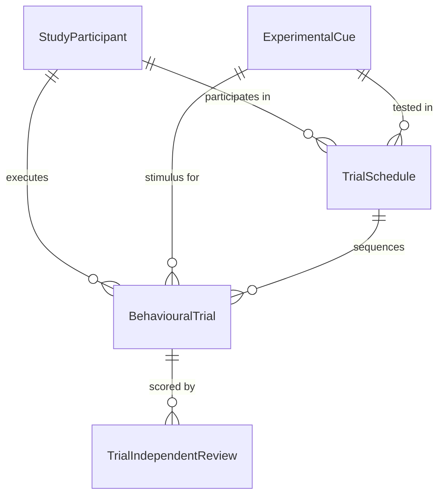

# CanineSense AI — Engine B Behavioural Trial Implementation Report
**Document ID:** `CS-DOC-P7-002`  
**Version:** 2.0.0 (Priority 7 Real-World Validation)  
**Status:** Implemented & Verified in Codebase  
**Date:** November 2026  
**Module Location:** `CanineSense_AI/backend/app/services/trial_service.py` & `CanineSense_AI/backend/app/routers/experiments.py`  
**Frontend Location:** `CanineSense_AI/frontend/src/pages/ValidationLab.tsx`  

---

## 1. Executive Summary & Objective

In Priority 7, the CanineSense AI platform transitioned from purely experimental synthesis toward a rigorous, auditable scientific trial platform for two-way canine communication. The central scientific problem is separating **sound generation** from **canine cognitive comprehension**:
$$\text{Acoustic Cue Generation} \neq \text{Acoustic Detection} \neq \text{Cue Discrimination} \neq \text{Conditioned Association} \neq \text{Intended Action Execution}$$

This report documents the architectural implementation of the **Engine B Behavioural Trial System**, covering participant cohort tracking, deterministic acoustic cue generation, Latin square counterbalancing, multi-camera blind video review, animal welfare guardrails, and statistical metric aggregation.

---

## 2. Relational Database Schema & Data Models

All models are implemented in SQLAlchemy under `CanineSense_AI/backend/app/models.py` with multi-tenant isolation keyed by `user_id`:

### 2.1 StudyParticipant Model (`study_participants`)
* **`id`** (`VARCHAR(36)`): Primary UUID key.
* **`user_id`** (`VARCHAR(36)`): Foreign key ensuring study and tenant isolation.
* **`pseudonym`** (`VARCHAR(64)`): De-identified participant code (e.g. `DOG-001`). No owner PII.
* **`breed`** (`VARCHAR(128)`): Biological breed or cross.
* **`sex`** (`VARCHAR(16)`): Biological sex (`male`, `female`, `unknown`).
* **`age_years`** (`FLOAT`): Age in years.
* **`familiarity_with_target_action`** (`VARCHAR(32)`): Baseline proficiency (`naive`, `emerging`, `proficient`).
* **`owner_consent_confirmed`** (`BOOLEAN`): Mandatory informed consent flag. Enforced at API boundary.
* **`welfare_review_confirmed`** (`BOOLEAN`): Mandatory veterinary acoustic/health clearance flag. Enforced at API boundary.
* **`training_history_notes`** (`TEXT`): Prior conditioning and handler context.

### 2.2 ExperimentalCue Model (`experimental_cues`)
* **`id`** (`VARCHAR(36)`): Primary UUID key.
* **`cue_label`** (`VARCHAR(128)`): Human-readable identifier.
* **`target_intention`** (`VARCHAR(64)`): Communicative goal (`come`, `play`, `stop`, `calm`, `stay`).
* **`target_action_description`** (`TEXT`): Explicit ethogram operational definition of the target motor response.
* **`action_category`** (`VARCHAR(64)`): Taxonomy category (`attention`, `learned_action`, `object_directed`, `location_directed`, `multi_step`).
* **`synthesis_method`** (`VARCHAR(64)`): Synthesis engine (`method_d_parametric_glottal`, `reference_audio_variant`).
* **`duration_sec`** (`FLOAT`): Cue duration in seconds.
* **`peak_spl_dba`** (`FLOAT`): Calibrated playback SPL at 1.0 m. **Strictly bounded $\le 75.0$ dBA.**
* **`f0_hz`** (`FLOAT`): Fundamental pitch frequency.
* **`sha256`** (`VARCHAR(64)`): Cryptographic hash of the uncompressed audio waveform verifying immutable stimulus consistency.

### 2.3 TrialSchedule Model (`trial_schedules`)
* **`id`** (`VARCHAR(36)`): Primary UUID key.
* **`participant_id`** (`VARCHAR(36)`): Associated participant.
* **`cue_id`** (`VARCHAR(36)`): Associated experimental cue.
* **`session_number`** (`INTEGER`): Longitudinal session index.
* **`randomization_seed`** (`INTEGER`): Deterministic pseudo-random seed reproducing the block sequence.
* **`schedule_type`** (`VARCHAR(64)`): `latin_square_counterbalanced`.
* **`planned_conditions_json`** (`TEXT`): JSON array of ordered conditions balancing Target and Controls (C1–C4).

### 2.4 BehaviouralTrial Model (`behavioural_trials`)
* **`id`** (`VARCHAR(36)`): Primary UUID key.
* **`session_id`** (`VARCHAR(64)`): Session identifier.
* **`trial_order_in_session`** (`INTEGER`): Order of presentation (1 to $N$).
* **`experimental_condition`** (`VARCHAR(64)`):
  * `target_engine_b_cue`: Synthesized vocal cue.
  * `control_silent_baseline` (C1): Unmodulated ambient silence.
  * `control_neutral_pure_tone` (C2): 500 Hz pure sine wave with 50 ms windowing.
  * `control_spectrally_matched_noise` (C3): Formant-shaped pink noise matching cue envelope.
  * `control_familiar_human_verbal_command` (C4): Established owner voice control.
* **`measured_spl_dba`** (`FLOAT`): Field SPL measurement ($\le 75.0$ dBA).
* **`pre_cue_state`** (`VARCHAR(32)`): Posture/activity immediately prior to onset (`resting`, `exploring`, `standing_relaxed`, `attentive`).
* **`latency_to_orient_ms`** (`FLOAT`): Milliseconds from stimulus onset to head/ear orientation.
* **`latency_to_action_ms`** (`FLOAT`): Milliseconds from stimulus onset to motor action initiation.
* **`outcome_category`** (`VARCHAR(64)`): Standardized 7-point ethological outcome scale:
  1. `correct_target_action`: Executed intended behaviour without handler cue.
  2. `attention_only`: Head turn or ear perk toward speaker without motor action.
  3. `incorrect_action`: Executed an off-target trained behaviour (e.g. sit instead of come).
  4. `alternative_behaviour`: Unrelated displacement or exploratory behavior.
  5. `no_observable_response`: Complete indifference to stimulus.
  6. `invalid_or_confounded`: Disturbance, handler cueing, or environmental artifact.
  7. `welfare_terminated`: Session aborted due to stress signs.
* **`freezing_observed`** (`BOOLEAN`): Tonic immobility or hyper-vigilance flag (**never treated as calmness**).
* **`abort_triggered`** (`BOOLEAN`): Instant session halt trigger.
* **`correction_audit_json`** (`TEXT`): Immutable append-only audit trail logging timestamp, author, previous value, new value, and rationale for any post-hoc correction.

### 2.5 TrialIndependentReview Model (`trial_independent_reviews`)
* **`id`** (`VARCHAR(36)`): Primary UUID key.
* **`trial_id`** (`VARCHAR(36)`): Associated trial.
* **`reviewer_name`** (`VARCHAR(128)`): Independent scorer identity.
* **`is_blind_to_condition`** (`BOOLEAN`): Confirms video review audio was masked or stripped.
* **`scored_outcome_category`** (`VARCHAR(64)`): Independent ethogram classification.
* **`disagreement_with_primary`** (`BOOLEAN`): Flagged automatically when blind score diverged from live score.

---

## 3. Mathematical & Control DSP Services

Implemented in `backend/app/services/trial_service.py`:

### 3.1 Control Signal Synthesis
* **C1 (Silent Baseline):** Generates zero-vector arrays for baseline arousal and spontaneous motor activity measurement:
  $$x_{\text{C1}}[n] = 0$$
* **C2 (Neutral Pure Tone):** Generates a 500.0 Hz sine tone with 50 ms cosine-squared ($\cos^2$) fade-in and fade-out ramps to eliminate transient onset clicks:
  $$x_{\text{C2}}[n] = w[n] \cdot \sin(2\pi \cdot 500 \cdot n / f_s)$$
* **C3 (Spectrally Matched Noise):** Generates Voss-McCartney pink noise filtered through a 2-pole recursive resonator centered at the cue's formant frequencies ($F_1, F_2$) and normalized to identical peak dBA.

### 3.2 Latin Square Counterbalancing Engine
The schedule generator (`generate_counterbalanced_schedule`) constructs pseudo-randomized blocks using seed-driven permutations ($S \in \mathbb{N}$):
* Intersperses Target cues with Controls C1, C2, C3, and C4.
* Prohibits consecutive identical conditions ($> 2$ occurrences).
* Ensures equal marginal distribution of conditions across early, mid, and late session positions.

---

## 4. REST API Endpoint Architecture

Mounted under `/api/experiments` with JWT Bearer authentication and rate limiting:

| Method | Endpoint | Description | Validation Constraints |
|---|---|---|---|
| `POST` | `/participants` | Register study dog | Consent & Welfare affirmation required |
| `GET` | `/participants` | List tenant participants | Scoped to active `user_id` |
| `POST` | `/cues` | Register experimental cue | SPL $\le 75.0$ dBA, SHA-256 generated |
| `GET` | `/cues` | List registered cues | Scoped to active `user_id` |
| `POST` | `/schedules` | Generate Latin square schedule | Deterministic seed, balanced blocks |
| `POST` | `/trials` | Record empirical trial | SPL $\le 75.0$ dBA, freezing handling |
| `GET` | `/trials` | List trials with review stats | Filter by participant or session |
| `PATCH` | `/trials/{id}` | Update/correct trial | Appends immutable audit entry |
| `POST` | `/reviews` | Submit blind video review | Anti-duplicate review, disagreement detection |
| `GET` | `/metrics` | Calculate scientific KPIs | Computes $D_{\text{ratio}}$, latencies, habituation |
| `GET` | `/export` | Export pseudonymous research archive | JSON or CSV with PII stripped |

---

## 5. Frontend Validation Lab UI

Located at `/app/experiments` (`CanineSense_AI/frontend/src/pages/ValidationLab.tsx`):
1. **Scientific Telemetry & Metrics Tab:** Real-time KPI cards for Target Congruence, $D_{\text{ratio}}$, Attention-Only Rate, Habituation Index, and Latency distributions.
2. **Trial Logger & Controls Tab:** Live session execution logger with millisecond latencies, 7-point outcome selector, acoustic SPL verification, and one-click welfare abort.
3. **Counterbalanced Schedules Tab:** Interactive Latin square schedule generator with seed tracking and condition sequence preview.
4. **Cue Setup & Taxonomy Tab:** Parameterized cue synthesizer configuration with veterinary volume guardrails and SHA-256 fingerprint display.
5. **Study Participants & Consent Tab:** Participant registry with explicit checkboxes for owner consent and animal welfare screening.
6. **Blind Video Review Modal:** Dedicated interface for secondary independent scorers with audio condition blinding.

---

## 6. Verification and Test Coverage

The implementation is verified by 9 targeted automated tests in `backend/tests/test_experimental_validation.py` as part of the 117-test backend suite:
* `test_participant_registration_requires_consent`: Verifies 400 Bad Request on missing consent/welfare.
* `test_experimental_cue_spl_cap`: Verifies rejection of cues $> 75.0$ dBA.
* `test_counterbalanced_schedule_reproducibility`: Verifies bitwise deterministic reproduction of Latin square schedules given identical seeds.
* `test_trial_logging_and_freezing_welfare`: Confirms freezing flags are recorded and cannot be scored as calm.
* `test_independent_blind_review_and_disagreement`: Verifies disagreement detection and prevention of duplicate reviews by the same evaluator.
* `test_trial_patch_audit_trail`: Confirms immutable JSON audit tracking on trial modifications.
* `test_metrics_calculation_discrimination_ratio`: Validates mathematical correctness of $D_{\text{ratio}}$ across Target and C1–C3 controls.
* `test_pseudonymous_export_privacy`: Confirms research exports contain zero owner PII, emails, or credentials.
* `test_tenant_isolation_experiments`: Confirms complete isolation across distinct research accounts.
